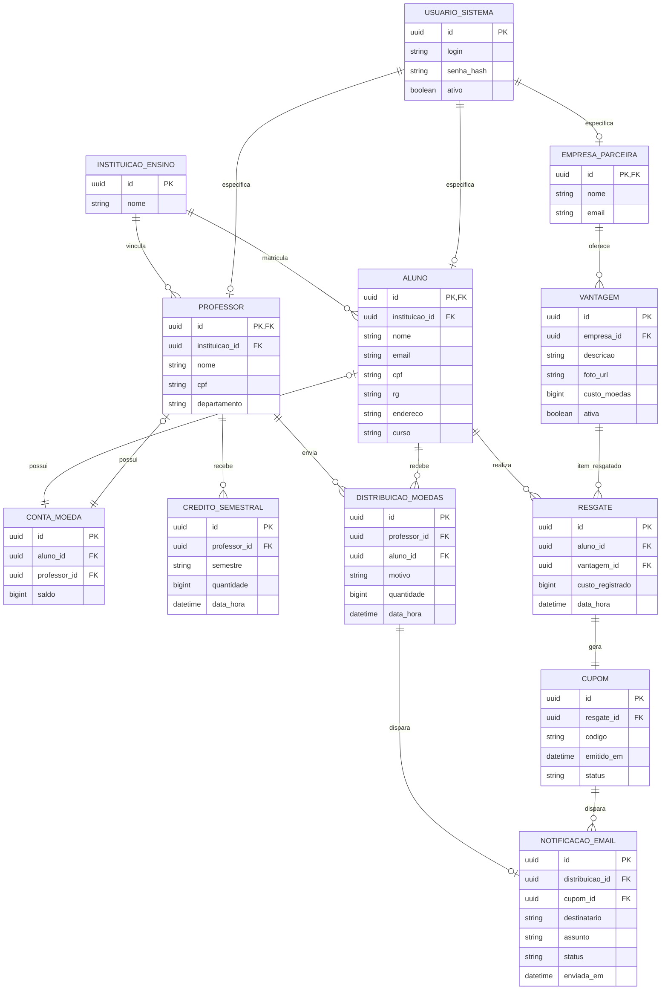
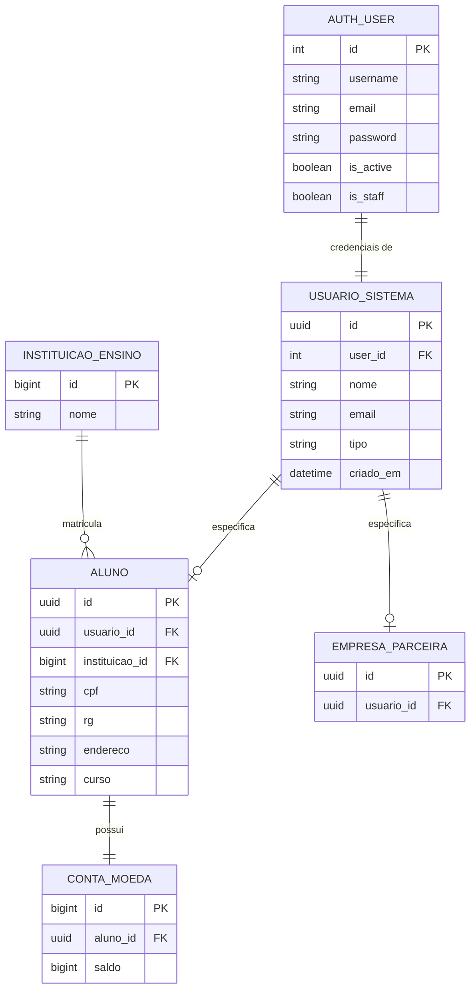
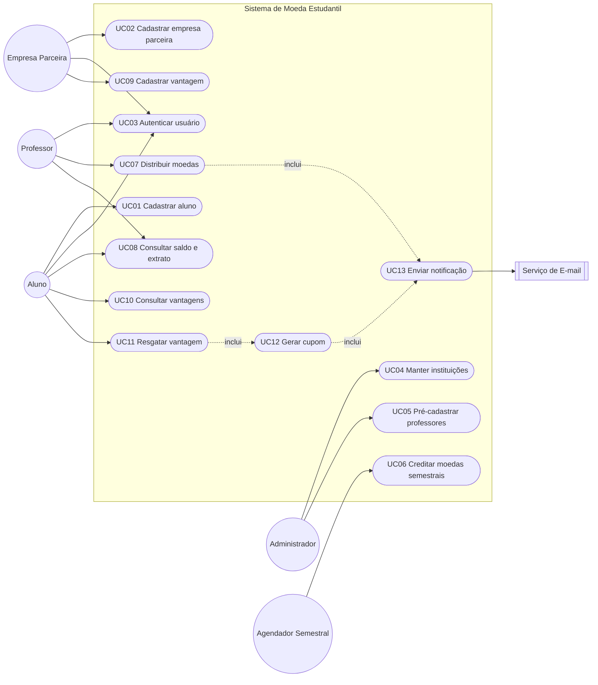
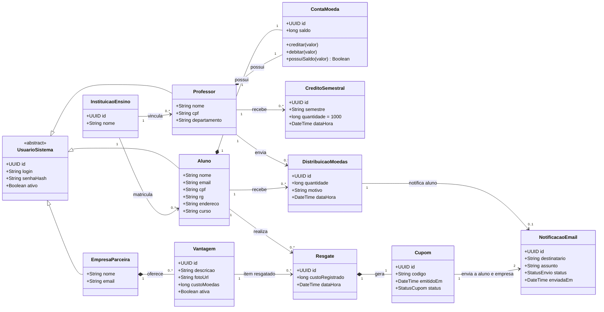
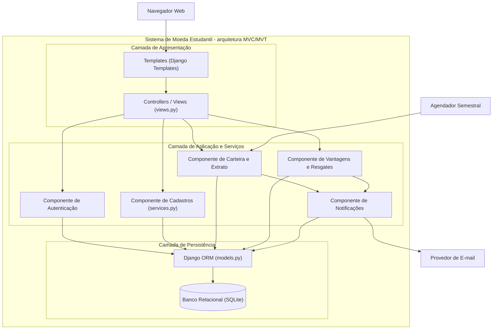

# Lab03S03 - Sistema de Moeda Estudantil (Arquitetura e Persistência)

**Disciplina:** Projeto de Software

**Sprint:** 03 - CRUDs Finais, Arquitetura do Sistema e Camada de Persistência

**Artefatos:** Visão geral MVT/ORM, Diagrama ER, Casos de Uso, Histórias de Usuário, Diagrama de Classes, Diagrama de Componentes, Rastreabilidade e explicação do código.

---

## Sumário

1. [Executar o projeto](#1-executar-o-projeto)
2. [Visão e escopo](#2-visão-e-escopo)
3. [Decisão da camada de persistência (ORM vs. DAO)](#3-decisão-da-camada-de-persistência-orm-vs-dao)
4. [Arquitetura em camadas (MVT + serviços)](#4-arquitetura-em-camadas-mvt--serviços)
5. [Como o código funciona](#5-como-o-código-funciona)
6. [Diagrama Entidade-Relacionamento](#6-diagrama-entidade-relacionamento)
7. [Diagrama de Casos de Uso](#7-diagrama-de-casos-de-uso)
8. [Histórias do Usuário](#8-histórias-do-usuário)
9. [Diagrama de Classes](#9-diagrama-de-classes)
10. [Diagrama de Componentes](#10-diagrama-de-componentes)
11. [Rastreabilidade de requisitos](#11-rastreabilidade-de-requisitos)
12. [Estado de implementação](#12-estado-de-implementação)
13. [Definição de pronto da Sprint 03](#13-definição-de-pronto-da-sprint-03)

---

## 1. Executar o projeto

Na raiz do repositório, pelo terminal PowerShell:

```powershell
python -m venv venv
.\venv\Scripts\Activate.ps1
pip install -r requirements.txt
python manage.py makemigrations
python manage.py migrate
python manage.py preparar_demo --senha teste@123
python manage.py runserver
```

- Se `python` não for reconhecido após a instalação, reabra o terminal ou use `py`.
- Com o ambiente já preparado, basta executar os dois últimos comandos.
- Acesse <http://127.0.0.1:8000/> e use `Ctrl+C` para parar o servidor.

Para criar um usuário administrador (opcional):

```powershell
.\venv\Scripts\python.exe manage.py createsuperuser
```

O painel administrativo fica em <http://127.0.0.1:8000/admin/>.

Para rodar os testes automatizados:

```powershell
python manage.py test
```

**Contas criadas por `preparar_demo`:** `admin_demo`, `aluno_demo` e `empresa_demo`, todas com a senha informada em `--senha`. O comando é idempotente e não altera contas já existentes.

---

## 2. Visão e escopo

O Sistema de Moeda Estudantil reconhece o mérito acadêmico por meio de uma moeda virtual. Professores distribuem moedas a alunos; alunos consultam o saldo e trocam moedas por vantagens oferecidas por empresas parceiras.

### Requisitos funcionais

| ID | Requisito funcional |
| --- | --- |
| RF01 | Permitir que o aluno se cadastre com nome, e-mail, CPF, RG, endereço, instituição de ensino e curso. |
| RF02 | Manter instituições e professores pré-cadastrados, vinculando cada professor a uma instituição. |
| RF03 | Permitir o cadastro de empresas parceiras. |
| RF04 | Autenticar alunos, professores e empresas parceiras com login e senha. |
| RF05 | Creditar 1.000 moedas a cada professor por semestre, acumulando o valor não utilizado. |
| RF06 | Permitir ao professor enviar moedas a um aluno, informando valor e motivo obrigatório, desde que possua saldo. |
| RF07 | Notificar o aluno por e-mail ao receber moedas. |
| RF08 | Permitir a alunos e professores consultar saldo e extrato de transações. |
| RF09 | Permitir à empresa cadastrar vantagens com descrição, foto e custo em moedas. |
| RF10 | Permitir ao aluno consultar as vantagens disponíveis. |
| RF11 | Permitir ao aluno resgatar uma vantagem se possuir saldo, descontando o custo da conta. |
| RF12 | Gerar um código de cupom único e enviá-lo por e-mail ao aluno e à empresa parceira após o resgate. |

### Premissas de modelagem

- O **Administrador do Sistema** representa a operação necessária para manter instituições e professores pré-cadastrados (suposição de modelagem, pois o enunciado não define quem faz isso).
- O **Agendador Semestral** representa o gatilho automático que credita 1.000 moedas aos professores no início de cada semestre.
- Para a empresa parceira, nome e e-mail são os dados mínimos.
- O saldo nunca pode ficar negativo; distribuição e resgate devem ser operações atômicas.
- Senhas são armazenadas somente como hash.

---

## 3. Decisão da camada de persistência (ORM vs. DAO)

- **Estratégia adotada:** **Django ORM** (Object-Relational Mapping).
- **Justificativa técnica:**
  - **Produtividade e integração:** o Django adota o padrão MVT (*Model-View-Template*). O ORM conecta os modelos às telas, aos formulários e ao painel administrativo sem código adicional.
  - **Desacoplamento e camada de serviço:** para evitar regras de negócio dentro das *views*, o módulo `cadastros/services.py` encapsula as operações compostas e garante **transações atômicas** entre `User`, `UsuarioSistema`, `Aluno`/`EmpresaParceira` e `ContaMoeda`.
  - **Segurança:** o ORM usa consultas parametrizadas, o que previne *SQL Injection*.
  - **Integridade no banco:** restrições como `CheckConstraint(saldo >= 0)`, `UniqueConstraint(Lower(email))` e `on_delete=PROTECT` são aplicadas pelo próprio banco, além das validações em Python.

---

## 4. Arquitetura em camadas (MVT + serviços)

```
Navegador
   │
   ▼
urls.py ──► views.py (Controller) ──► forms.py (validação de entrada)
                │                          │
                ▼                          ▼
          services.py (regras e transações atômicas)
                │
                ▼
          models.py (Django ORM) ──► SQLite
                ▲
                │
        templates/ (View/Template) renderizam o contexto vindo das views
```

| Camada | Arquivo(s) | Responsabilidade |
| --- | --- | --- |
| Roteamento | `config/urls.py`, `cadastros/urls.py` | Mapeia URLs para views; conversor `<tipo:tipo>` aceita só `alunos` ou `empresas`. |
| Apresentação | `templates/cadastros/*.html`, `static/cadastros/style.css` | Telas de início, login, lista, detalhe, formulário e exclusão; páginas 403 e 404. |
| Controle | `views.py` | Recebe a requisição, aplica autorização, chama formulário e serviço, escolhe o template/redirect. |
| Validação | `forms.py`, `validators.py` | Normaliza e valida CPF, RG, e-mail, login e senha. |
| Serviço | `services.py` | `salvar_cadastro` e `excluir_cadastro`, ambos atômicos. |
| Persistência | `models.py`, `migrations/` | Entidades, restrições e relacionamentos. |
| Administração | `admin.py` | Painel somente leitura para cadastros; instituições editáveis. |
| Carga inicial | `management/commands/preparar_demo.py` | Cria dados de demonstração de forma idempotente. |

---

## 5. Como o código funciona

### 5.1 Modelos (`models.py`)

```
User (Django: login + hash da senha)
  └─1:1─ UsuarioSistema (nome, e-mail, tipo: aluno/empresa)
            ├─1:1─ Aluno (cpf, rg, endereço, curso, → InstituicaoEnsino)
            │         └─1:1─ ContaMoeda (saldo)
            └─1:1─ EmpresaParceira
```

- **Reuso do `User` do Django:** login, hash de senha e autenticação ficam no `User` nativo. `UsuarioSistema` guarda os dados comuns (nome, e-mail, tipo) e faz o papel da classe abstrata `UsuarioSistema` do diagrama de classes.
- **`Aluno`** e **`EmpresaParceira`** são perfis ligados a `UsuarioSistema` por `OneToOneField`.
- **`ContaMoeda`** nasce junto com o aluno com saldo 0. O campo é `PositiveBigIntegerField`, `editable=False` (não aparece em formulários) e há `CheckConstraint(saldo >= 0)`.
- **`InstituicaoEnsino`** usa `on_delete=PROTECT`: não é possível apagar uma instituição que tenha alunos.
- **Unicidade:** CPF, RG e nome de instituição são únicos; e-mail é único sem distinguir maiúsculas/minúsculas.

### 5.2 Validações (`validators.py` e `forms.py`)

- **CPF:** remove pontuação, exige 11 dígitos, rejeita sequências repetidas e calcula os dois dígitos verificadores.
- **RG:** remove pontuação/espaços, converte para maiúsculas e aceita de 3 a 20 letras ou números.
- **`CadastroForm`** (base de aluno e empresa):
  - normaliza e-mail e login para minúsculas e checa duplicidade, ignorando o próprio registro na edição;
  - exige confirmação de senha e aplica os validadores de senha do Django;
  - na edição, os campos de senha são opcionais: vazios significam "manter a senha atual".
- **`AlunoForm`** acrescenta CPF, RG, endereço, instituição e curso. **`EmpresaForm`** usa só os campos comuns, com o rótulo "Nome da empresa".

### 5.3 Serviços (`services.py`)

**`salvar_cadastro(form)`** (`@transaction.atomic`):

1. cria ou atualiza o `User` (`set_password` só se houve senha nova);
2. cria ou atualiza o `UsuarioSistema`;
3. salva o `Aluno` ou a `EmpresaParceira`;
4. se for aluno, cria a `ContaMoeda` (`get_or_create`).

Se qualquer passo falhar, nada é gravado, evitando `User` sem perfil ou aluno sem conta. Há um teste específico para esse rollback.

**`excluir_cadastro(registro)`** apaga o `User`; a cascata remove perfil, aluno e conta. Apagar só o perfil deixaria credenciais órfãs.

### 5.4 Views e permissões (`views.py`)

O dicionário `CONFIG` associa `alunos`/`empresas` a modelo, formulário e rótulos, permitindo **um único conjunto de views** para os dois CRUDs.

| Rota | View | Acesso |
| --- | --- | --- |
| `/` | `inicio` | Público; usuário comum logado é redirecionado ao próprio perfil; admin vê contadores. |
| `/entrar/`, `/sair/` | `LoginView`, `LogoutView` | Todos. |
| `/<tipo>/` | `lista` (busca e paginação de 10) | Somente admin (`is_staff`). |
| `/<tipo>/novo/` | `criar` | Visitantes e admin; quem já possui cadastro recebe 403. |
| `/<tipo>/<uuid>/` | `detalhe` | Dono do cadastro ou admin. |
| `/<tipo>/<uuid>/editar/` | `editar` | Dono ou admin. |
| `/<tipo>/<uuid>/excluir/` | `excluir` (confirmação por POST) | Dono ou admin. |

- `verificar_acesso` levanta `PermissionDenied` (403) se o usuário não for staff nem dono do registro.
- IDs são **UUIDs**, o que dificulta enumeração de URLs.
- `update_session_auth_hash` mantém a sessão ativa quando o usuário troca a própria senha.
- `IntegrityError` e `ValidationError` viram mensagem amigável no formulário.
- Logout por POST e proteção CSRF em todos os formulários.

### 5.5 Administração e carga inicial

- **`admin.py`:** cadastros, usuários e contas são somente leitura (a escrita deve passar por telas e serviços para preservar a transação). Instituições são editáveis, e é por lá que o administrador as pré-cadastra.
- **`preparar_demo`:** valida a senha, cria a instituição fictícia, o superusuário `admin_demo` e as contas de aluno e empresa usando os próprios formulários e `salvar_cadastro`. Contas existentes são preservadas.

### 5.6 Testes (`tests.py`)

Cobrem: CRUD completo de aluno e empresa; normalização de CPF/RG e saldo inicial zero; duplicidades sem dados parciais; rollback da transação; autorização (sem login e sem propriedade); CSRF; login incorreto/inativo e logout por POST; troca de senha; saldo não editável; restrições do banco e proteção de instituição; renderização das páginas; idempotência do `preparar_demo`.

---

## 6. Diagrama Entidade-Relacionamento

### 6.1 Modelo alvo (domínio completo)

Mapeamento relacional derivado do Diagrama de Classes de Domínio, incluindo as entidades ainda não implementadas.



### 6.2 Modelo efetivamente implementado hoje

Reflete `cadastros/models.py` e a migração `0001_initial`. A diferença principal em relação ao modelo alvo: login, hash de senha e flag `ativo` ficam na tabela `auth_user` do Django, e `UsuarioSistema` guarda os dados comuns.



---

## 7. Diagrama de Casos de Uso



> UC07 a UC11 exigem sessão autenticada. A autenticação foi mantida como caso de uso independente para evitar poluir o diagrama com relações repetidas.

---

| Caso de uso | Ator principal | Pré-condição | Fluxo principal e resultado |
| --- | --- | --- | --- |
| UC01 - Cadastrar aluno | Aluno | Instituição disponível para seleção | Informa os dados obrigatórios, escolhe a instituição e o curso e cria as credenciais. O sistema valida unicidade de CPF, RG, e-mail e login e cria a conta com saldo zero. |
| UC02 - Cadastrar empresa | Empresa Parceira | Não possuir cadastro | Informa identificação, e-mail e credenciais. O sistema valida os dados e cria a empresa. |
| UC03 - Autenticar usuário | Aluno, Professor ou Empresa | Usuário cadastrado e ativo | Informa login e senha. O sistema valida as credenciais e inicia uma sessão associada ao perfil. |
| UC06 - Creditar moedas semestrais | Agendador Semestral | Novo semestre identificado | Para cada professor ativo, registra um crédito de 1.000 moedas. O valor é somado ao saldo existente e a execução não pode duplicar o crédito do mesmo semestre. |
| UC07 - Distribuir moedas | Professor | Professor autenticado e com saldo suficiente | Seleciona aluno, informa valor positivo e motivo não vazio. O sistema debita o professor, credita o aluno, registra a distribuição e solicita o e-mail de notificação. Se o saldo for insuficiente, nada é alterado. |
| UC08 - Consultar saldo e extrato | Aluno ou Professor | Usuário autenticado | Exibe o saldo atual e as transações da própria conta em ordem cronológica decrescente. |
| UC09 - Cadastrar vantagem | Empresa Parceira | Empresa autenticada | Informa descrição, foto e custo positivo em moedas. O sistema associa a vantagem à empresa e a disponibiliza no catálogo. |
| UC11 - Resgatar vantagem | Aluno | Aluno autenticado, vantagem ativa e saldo suficiente | O sistema debita o custo, registra o resgate, gera um cupom único e envia o mesmo código ao aluno e à empresa. Se o saldo for insuficiente ou a vantagem estiver inativa, nada é alterado. |

---

## 8. Histórias do Usuário

### HU01 - Cadastro de aluno

**Como** aluno, **quero** criar minha conta selecionando minha instituição e informando meus dados acadêmicos, **para** participar do programa de reconhecimento.

- **Dado** que a instituição esteja pré-cadastrada, **quando** o aluno preencher todos os dados válidos, **então** a conta é criada com saldo zero.
- **Dado** CPF, RG, e-mail ou login já utilizado, **quando** o cadastro for enviado, **então** o sistema o rejeita sem criar dados parciais.
- **Dado** campo obrigatório ausente, **quando** o cadastro for enviado, **então** o sistema informa os campos a corrigir.

### HU02 - Cadastro de empresa parceira

**Como** representante de uma empresa parceira, **quero** cadastrar a empresa e suas credenciais, **para** oferecer vantagens aos alunos.

- **Dado** dados e credenciais válidos, **quando** o cadastro for confirmado, **então** a empresa é criada e pode se autenticar.
- **Dado** e-mail ou login já utilizado, **quando** o cadastro for enviado, **então** o sistema recusa a duplicação.

### HU03 - Autenticação

**Como** aluno, professor ou empresa parceira, **quero** entrar com login e senha, **para** acessar com segurança as funções do meu perfil.

- Credenciais corretas iniciam uma sessão com o perfil correspondente.
- Login inexistente ou senha incorreta negam o acesso sem revelar qual campo está errado.
- Usuário não autenticado em operação protegida é direcionado ao login.

### HU04 - Pré-cadastro institucional

**Como** administrador do sistema, **quero** manter instituições e pré-cadastrar professores vinculados a elas, **para** disponibilizar dados confiáveis no programa.

- **Dado** uma instituição participante, **quando** ela for cadastrada, **então** ela aparece na seleção do cadastro de aluno.
- **Dado** nome, CPF, departamento, login, senha inicial e instituição, **quando** o professor for pré-cadastrado, **então** ele é criado explicitamente vinculado à instituição.
- **Dado** um CPF ou login existente, **quando** o pré-cadastro for solicitado, **então** o sistema impede a duplicidade.

### HU05 - Crédito semestral

**Como** professor, **quero** receber 1.000 moedas a cada semestre, **para** reconhecer o mérito dos meus alunos.

- **Dado** o início de um novo semestre, **quando** o processamento semestral ocorrer, **então** 1.000 moedas são somadas ao saldo de cada professor ativo.
- O saldo anterior é preservado e acrescido de 1.000.
- Reexecutar a rotina no mesmo semestre não duplica o crédito.

### HU06 - Distribuição de moedas

**Como** professor, **quero** enviar moedas a um aluno e registrar o motivo, **para** reconhecer sua participação ou bom comportamento.

- Débito do professor e crédito do aluno ocorrem em uma única transação.
- Saldo insuficiente, valor não positivo ou motivo vazio rejeitam a operação sem alterar saldos.
- Após a conclusão, o aluno recebe e-mail com valor, professor e motivo.

### HU07 - Consulta de saldo e extrato

**Como** aluno ou professor, **quero** consultar meu saldo e minhas transações, **para** acompanhar a movimentação da conta.

- **Dado** um usuário autenticado, **quando** abrir o extrato, **então** ele visualiza seu saldo atual e somente suas transações.
- **Dado** um professor, **quando** consultar o extrato, **então** ele vê créditos semestrais e envios realizados.
- **Dado** um aluno, **quando** consultar o extrato, **então** ele vê moedas recebidas e resgates realizados.

### HU08 - Cadastro de vantagem

**Como** empresa parceira, **quero** cadastrar uma vantagem com descrição, foto e custo, **para** disponibilizá-la aos alunos.

- **Dado** descrição e foto preenchidas e custo positivo, **quando** a empresa confirmar o cadastro, **então** a vantagem é vinculada à empresa e fica disponível no catálogo.
- Custo nulo ou não positivo é rejeitado.
- Somente a empresa proprietária pode alterar a vantagem.

### HU09 - Consulta de vantagens

**Como** aluno, **quero** visualizar as vantagens disponíveis e seus custos, **para** escolher onde utilizar minhas moedas.

- **Dado** um aluno autenticado, **quando** acessar o catálogo, **então** ele vê as vantagens ativas com descrição, foto, empresa e custo.
- **Dado** uma vantagem inativa, **quando** o catálogo for exibido, **então** ela não está disponível para resgate.

### HU10 - Resgate de vantagem

**Como** aluno, **quero** trocar minhas moedas por uma vantagem, **para** utilizar o benefício presencialmente.

- Débito, registro do resgate e geração do cupom único ocorrem em uma única transação.
- Saldo insuficiente ou vantagem inativa impedem o resgate.
- Aluno e empresa recebem por e-mail o mesmo código do cupom.

---

## 9. Diagrama de Classes



### Invariantes do domínio

- `ContaMoeda.saldo >= 0`.
- Quantidade distribuída e custo da vantagem são maiores que zero.
- Toda `DistribuicaoMoedas` possui professor, aluno, quantidade e motivo não vazio.
- Existe no máximo um `CreditoSemestral` por professor e semestre.
- `Vantagem.custoMoedas` é copiado para `Resgate.custoRegistrado`, preservando o histórico.
- `Cupom.codigo` é único e o mesmo código é comunicado ao aluno e à empresa.
- Débitos, créditos e registros associados são persistidos de forma atômica.

---

## 10. Diagrama de Componentes



---

| Componente | Responsabilidade |
| --- | --- |
| Templates (Django Templates) | Formulários, catálogo, saldo, extrato e feedback ao usuário. |
| Controllers / Views (`views.py`) | Receber requisições, validar formato de entrada, aplicar autorização por perfil e coordenar casos de uso. |
| Autenticação | Validar credenciais, manter sessões e proteger operações por perfil. |
| Cadastros (`services.py`) | Cadastrar alunos e empresas e manter instituições/professores pré-cadastrados. |
| Carteira e Extrato | Controlar saldos, créditos semestrais, distribuições e consultas de extrato. |
| Vantagens e Resgates | Manter o catálogo, validar saldo/vantagem, registrar o resgate e gerar cupom único. |
| Notificações | Montar, enviar e registrar e-mails de distribuição e resgate. |
| Django ORM (`models.py`) | Isolar o domínio do mecanismo de persistência e controlar transações atômicas. |

---

## 11. Rastreabilidade de requisitos

| Requisito | Caso de uso | História | Classes centrais | Componente principal |
| --- | --- | --- | --- | --- |
| RF01 | UC01 | HU01 | Aluno, InstituicaoEnsino, ContaMoeda | Cadastros |
| RF02 | UC04, UC05 | HU04 | InstituicaoEnsino, Professor | Cadastros |
| RF03 | UC02 | HU02 | EmpresaParceira | Cadastros |
| RF04 | UC03 | HU03 | UsuarioSistema | Autenticação |
| RF05 | UC06 | HU05 | Professor, ContaMoeda, CreditoSemestral | Carteira e Extrato |
| RF06, RF07 | UC07, UC13 | HU06 | DistribuicaoMoedas, ContaMoeda, NotificacaoEmail | Carteira e Extrato / Notificações |
| RF08 | UC08 | HU07 | ContaMoeda, CreditoSemestral, DistribuicaoMoedas, Resgate | Carteira e Extrato |
| RF09 | UC09 | HU08 | EmpresaParceira, Vantagem | Vantagens e Resgates |
| RF10 | UC10 | HU09 | Vantagem | Vantagens e Resgates |
| RF11, RF12 | UC11, UC12, UC13 | HU10 | Resgate, Vantagem, Cupom, NotificacaoEmail | Vantagens e Resgates / Notificações |

---

## 12. Estado de implementação

| Requisito | Situação no código | Observação |
| --- | --- | --- |
| RF01 Cadastro de aluno | Implementado | CRUD completo, validação de CPF/RG, conta criada com saldo 0. |
| RF02 Instituições e professores | Parcial | Instituições editáveis pelo admin; **professores ainda não existem no código**. |
| RF03 Cadastro de empresa | Implementado | CRUD completo. |
| RF04 Autenticação | Implementado | Login/logout via `django.contrib.auth`; perfis de aluno e empresa. |
| RF05 a RF07 | Pendente | Crédito semestral, distribuição de moedas e e-mail. |
| RF08 | Pendente | `ContaMoeda` existe, mas não há extrato nem transações. |
| RF09 a RF12 | Pendente | Vantagens, resgate, cupom e e-mails. |

O Diagrama ER da seção 6.1 e o Diagrama de Classes descrevem o **modelo alvo**; a seção 6.2 mostra o que está no banco hoje.

---

## 13. Definição de pronto da Sprint 03

- [x] Modelo ER construído com base no Diagrama de Classes de Domínio.
- [x] Estratégia de persistência (Django ORM) definida e documentada.
- [x] CRUDs de Aluno e Empresa Parceira integrados com front-end (HTML/CSS) e back-end.
- [x] Arquitetura em camadas (MVT + camada de serviços em `services.py`) implementada.
- [x] Script de carga inicial (`preparar_demo`) funcional.
- [ ] CRUD de Professor e vínculo com instituição (RF02), a implementar.
- [ ] Validar com a professora as premissas de Administrador e Agendador Semestral.
- [ ] Mover `SECRET_KEY` e `DEBUG` para variáveis de ambiente antes de qualquer deploy.
